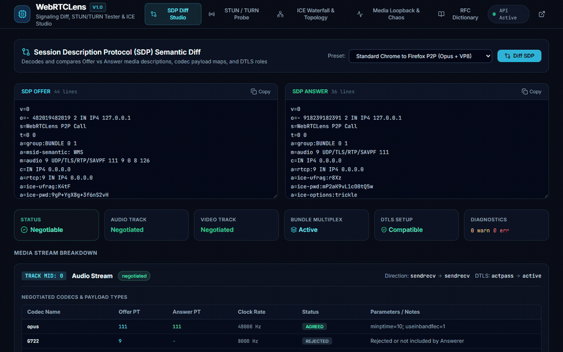
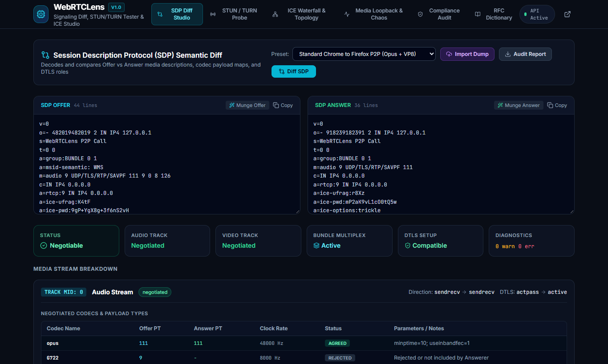
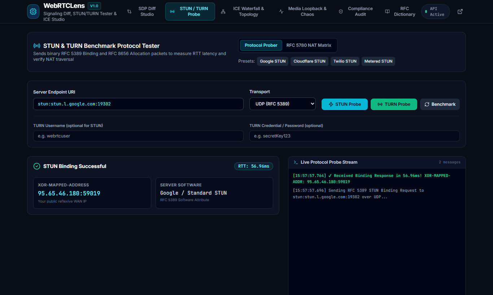
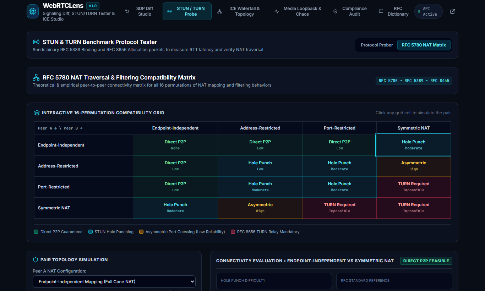
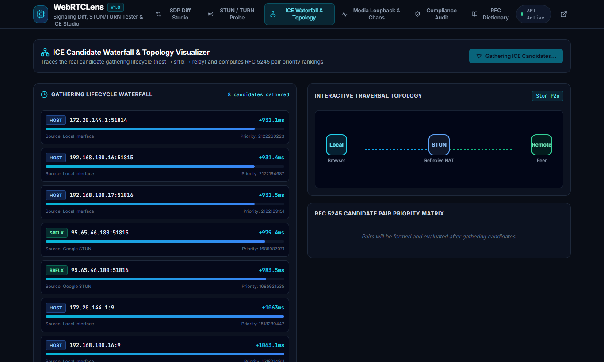
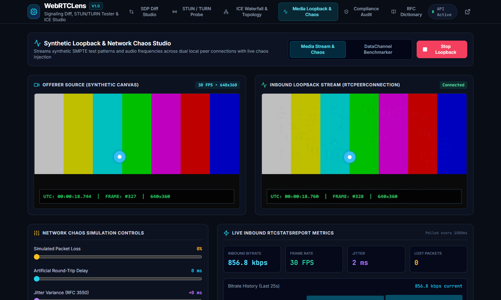
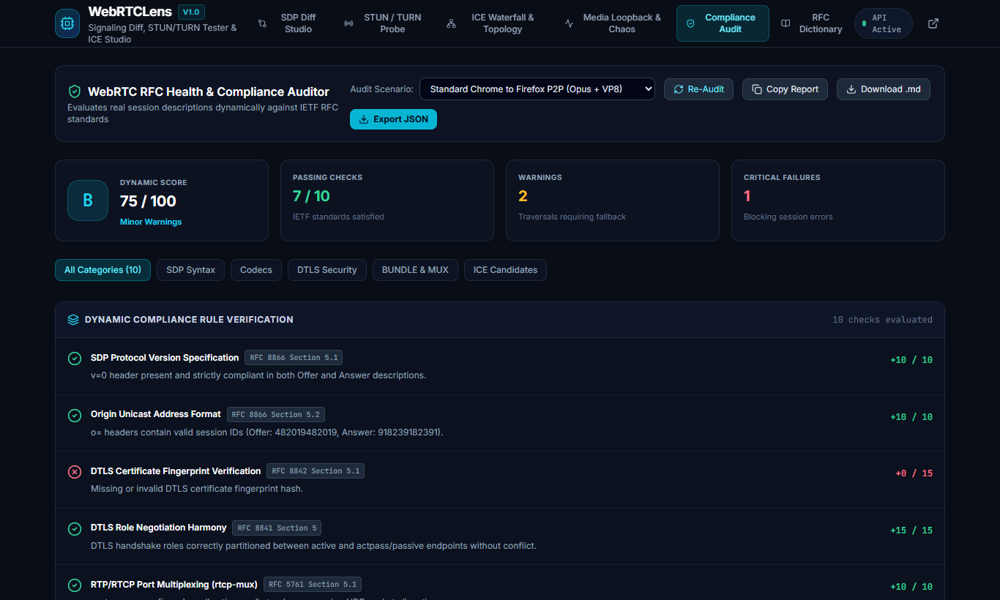

<p align="center">
  
</p>

<h1 align="center">WebRTCLens</h1>

<p align="center">
  <strong>Interactive WebRTC Media &amp; Signaling Workbench, SDP Diff Engine, STUN/TURN Tester &amp; ICE Topology Visualizer</strong>
</p>

<p align="center">
  <a href="https://github.com/alexandrmotologa/webrtclens/blob/main/LICENSE"></a>
  <a href="https://nodejs.org"></a>
  <a href="https://react.dev"></a>
  <a href="https://fastify.dev"></a>
</p>

---

## Overview

WebRTCLens is a local developer studio and command-line inspector for real-time WebRTC communications. It resolves common debugging bottlenecks in WebRTC applications:

1. **Semantic SDP Diffing**: Parses raw Session Description Protocol (SDP) offers and answers into typed Abstract Syntax Trees (ASTs). Highlights codec negotiation matches, rejected payload types, DTLS fingerprint alignment, and media direction conflicts.
2. **STUN and TURN Benchmarking**: Sends real binary RFC 5389 Binding and RFC 8656 Allocation packets over UDP, TCP, and TLS. Measures Round Trip Time (RTT), extracts `XOR-MAPPED-ADDRESS`, and verifies credential authentication.
3. **ICE Waterfall and Topology**: Maps the gathering lifecycle (`host`, `srflx`, `prflx`, `relay`), computes RFC 5245 pair priorities, and visualizes candidate pairing states.
4. **Media Loopback and Chaos Testing**: Runs an in-browser loopback between dual peer connections with synthetic video test patterns, audio tone generators, and configurable packet loss, delay, and jitter simulation.

---

## Live Demo & Visuals



### Studio Workbenches

| SDP Diff Studio & Codec Matrix | STUN & TURN Protocol Prober |
|---|---|
|  |  |

| RFC 5780 NAT Compatibility Matrix | ICE Candidate Waterfall & Topology |
|---|---|
|  |  |

| Media Loopback & Chaos Simulation | RFC Health & Compliance Auditor |
|---|---|
|  |  |

---

## Key Features

- **Side-by-Side SDP Diff Studio**: Visual line-by-line and semantic comparison with color-coded codec matching tables, payload type tracking, and DTLS role verification (`actpass` vs `active`/`passive`).
- **Interactive SDP Munger**: Strip unwanted codecs, prefer specific codecs on m-lines, enforce bandwidth limits (`b=AS`/`b=TIAS`), modify DTLS setup roles, and enable Opus stereo parameters.
- **Binary STUN/TURN Client**: Native encoder and decoder for RFC 5389 and RFC 8656 packets with HMAC-SHA1 message integrity, CRC-32 fingerprints, and 401 challenge processing.
- **RFC 5780 NAT Compatibility Matrix**: Interactive 16-permutation NAT matrix classifying direct peer-to-peer viability, hole-punching difficulty, and mandatory relay requirements.
- **DataChannel Throughput & Latency Benchmarker**: Measures sustained binary throughput (Mbps), SCTP backpressure, round-trip ping latency, and RFC 3550 jitter.
- **chrome://webrtc-internals Importer**: Ingests browser JSON and text diagnostics to extract session descriptions and ICE candidate exchanges.
- **RFC Health & Compliance Auditor**: Automated verification and grading against IETF specifications (RFC 8866, RFC 8841, RFC 8842, RFC 8843, RFC 5245).
- **ICE Priority Matrix**: Calculates pair priorities using RFC 5245 formulas and detects potential NAT traversal failures before deployment.
- **Network Chaos Controls**: Simulates packet loss (1% to 50%), artificial latency (0ms to 800ms), and jitter buffers directly on WebRTC media streams while collecting real-time `RTCStatsReport` metrics.
- **Unified Interface**: Use WebRTCLens as an interactive React 19 web app, a headless Fastify REST API, or a standalone command-line tool.

---

## Installation

### Prerequisites
- Node.js 22.0.0 or higher
- npm 10+ or equivalent package manager

```bash
git clone https://github.com/alexandrmotologa/webrtclens.git
cd webrtclens
npm install
npm run build:all
```

---

## Command Line Usage

WebRTCLens includes a standalone CLI binary:

```bash
# Compare two SDP files with semantic analysis
npx webrtclens diff offer.sdp answer.sdp

# Output comparison as structured JSON
npx webrtclens diff offer.sdp answer.sdp --json

# Probe a STUN server over UDP
npx webrtclens probe stun:stun.l.google.com:19302

# Probe a TURN server with credentials over TLS
npx webrtclens probe turn:turn.example.com:5349 --user webrtc --pass secret --transport tls

# Run 5 consecutive latency probes
npx webrtclens probe stun:stun1.l.google.com:19302 --count 5

# Generate executive compliance audit report in Markdown format
npx webrtclens audit offer.sdp answer.sdp

# Generate structured JSON audit report for CI pipelines
npx webrtclens audit offer.sdp answer.sdp --format json

# Launch the interactive Web Studio and API server
npx webrtclens serve --port 3000
```

---

## REST API Reference

When running `webrtclens serve`, the following endpoints are available:

| Method | Endpoint | Description |
|---|---|---|
| `GET` | `/api/health` | Service health status |
| `POST` | `/api/sdp/parse` | Parse raw SDP into typed AST |
| `POST` | `/api/sdp/diff` | Calculate semantic diff between offer and answer |
| `GET` | `/api/sdp/samples` | List pre-configured real-world SDP scenarios |
| `POST` | `/api/probe/stun` | Execute binary STUN binding request |
| `POST` | `/api/probe/turn` | Execute RFC 8656 TURN allocation probe |
| `POST` | `/api/probe/benchmark` | Run multi-iteration latency and jitter benchmark |
| `POST` | `/api/ice/analyze` | Evaluate candidate pairs and calculate RFC 5245 priorities |
| `POST` | `/api/sdp/munge` | Transform SDP with codec stripping, preference, or bitrate limits |
| `POST` | `/api/sdp/import-internals` | Parse and extract session descriptions from webrtc-internals dumps |
| `GET` | `/api/nat/matrix` | Full 16-permutation RFC 5780 NAT compatibility matrix |
| `POST` | `/api/nat/evaluate` | Evaluate peer-to-peer viability between two NAT configurations |
| `POST` | `/api/audit/markdown` | Generate Markdown compliance audit report |
| `POST` | `/api/audit/json` | Generate structured JSON compliance audit report |

---

## Architecture

Detailed protocol specifications, binary message structures, and RFC references are documented in [docs/ARCHITECTURE.md](docs/ARCHITECTURE.md).

---

## Development

```bash
# Run server in watch mode
npm run dev:server

# Run frontend in development mode
npm run dev:web

# Run automated test suite
npm run test:ts
```

---

## License

MIT License. See [LICENSE](LICENSE) for details.
